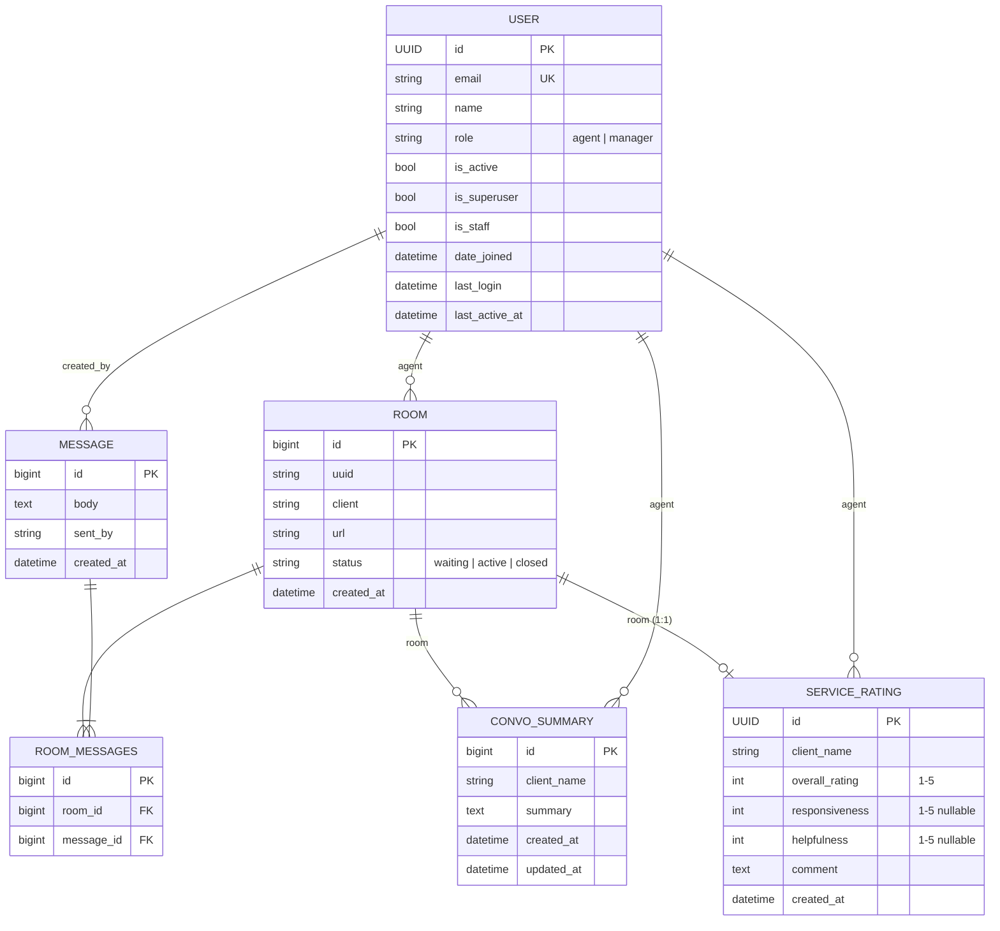

# valCRI -- Database Documentation

> **Engine:** SQLite 3 (`db.sqlite3`)
> **ORM:** Django 6.1
> **Default PK type:** `BigAutoField` (except where overridden with `UUIDField`)

---

## Table of Contents

- [Overview](#overview)
- [Entity-Relationship Diagram](#entity-relationship-diagram)
- [Apps & Models](#apps--models)
  - [account](#account-app)
  - [chat](#chat-app)
  - [administration](#administration-app)
  - [core](#core-app)
  - [Django built-in tables](#django-built-in-tables)
- [Relationships Summary](#relationships-summary)
- [Indexes & Constraints](#indexes--constraints)
- [Migrations](#migrations)
- [Session & Timeout Behaviour](#session--timeout-behaviour)
- [Common Queries](#common-queries)

---

## Overview

valCRI is a **real-time customer-support chat platform** built with Django and Django Channels (Daphne / ASGI). The database stores:

| Concern | Tables |
|---|---|
| Identity & access | `account_user`, Django auth group/permission tables |
| Live chat | `chat_room`, `chat_message`, `chat_room_messages` (M2M) |
| Post-chat analytics | `chat_convosummary`, `chat_servicerating` |
| Sessions | `django_session` |

The `administration` and `core` apps contain **no custom models** -- they provide dashboard views and landing pages that query the tables above.

---

## Entity-Relationship Diagram



---

## Apps & Models

### `account` App

#### `User` -- _Custom user model_ (`account.User`)

Replaces Django's default user with UUID primary keys and role-based access.

| Column | Type | Constraints | Notes |
|---|---|---|---|
| `id` | `UUIDField` | **PK**, default `uuid4` | Non-sequential, globally unique |
| `email` | `EmailField` | **Unique**, required | Used as `USERNAME_FIELD` |
| `name` | `CharField(255)` | blank, default `''` | Display name |
| `role` | `CharField(20)` | choices: `agent`, `manager` | Default `agent` |
| `is_active` | `BooleanField` | default `True` | Soft-delete / deactivation flag |
| `is_superuser` | `BooleanField` | default `False` | Full Django admin access |
| `is_staff` | `BooleanField` | default `False` | Can log into agent dashboard |
| `date_joined` | `DateTimeField` | default `timezone.now` | Account creation timestamp |
| `last_login` | `DateTimeField` | nullable | Updated by Django auth on login |
| `last_active_at` | `DateTimeField` | nullable | Set on logout / session timeout |

**Manager:** `CustomUserManager` -- overrides `create_user` / `create_superuser` to require `email` + `name`.

**Signals:**
- `user_logged_in` -> stamps `login_time` and `last_activity` into the session.
- `user_logged_out` -> persists `last_active_at` on the `User` row from the session's `last_activity`.

---

### `chat` App

#### `Message`

An individual chat message -- either from a client or an agent.

| Column | Type | Constraints | Notes |
|---|---|---|---|
| `id` | `BigAutoField` | **PK** | Auto-increment |
| `body` | `TextField` | required | Message content |
| `sent_by` | `CharField(255)` | required | Display name of sender |
| `created_by` | `ForeignKey -> User` | nullable, `SET_NULL` | Only populated for agent messages |
| `created_at` | `DateTimeField` | `auto_now_add` | Immutable timestamp |

**Ordering:** `created_at` ascending.

---

#### `Room`

A chat session between a client and (optionally) an agent.

| Column | Type | Constraints | Notes |
|---|---|---|---|
| `id` | `BigAutoField` | **PK** | Auto-increment |
| `uuid` | `CharField(255)` | -- | Public room identifier (used in WebSocket URL) |
| `client` | `CharField(255)` | -- | Client's display name |
| `agent` | `ForeignKey -> User` | nullable, `SET_NULL` | Assigned agent (`related_name='rooms'`) |
| `messages` | `ManyToManyField -> Message` | blank | Through table: `chat_room_messages` |
| `url` | `CharField(255)` | nullable | Page URL where chat was initiated |
| `status` | `CharField(20)` | choices below, default `waiting` | Room lifecycle state |
| `created_at` | `DateTimeField` | `auto_now_add` | Immutable timestamp |

**Status choices:**

| Value | Meaning |
|---|---|
| `waiting` | Client connected, no agent assigned yet |
| `active` | Agent has joined the conversation |
| `closed` | Conversation ended (client disconnected or manually closed) |

**Ordering:** `created_at` descending (newest first).

---

#### `ConvoSummary`

Agent-written summary for a completed conversation.

| Column | Type | Constraints | Notes |
|---|---|---|---|
| `id` | `BigAutoField` | **PK** | Auto-increment |
| `client_name` | `CharField(255)` | required | Denormalised from `Room.client` |
| `room` | `ForeignKey -> Room` | `CASCADE`, `related_name='summaries'` | |
| `agent` | `ForeignKey -> User` | nullable, `SET_NULL`, `related_name='convo_summaries'` | |
| `summary` | `TextField` | blank, default `''` | Free-text summary |
| `created_at` | `DateTimeField` | `auto_now_add` | |
| `updated_at` | `DateTimeField` | `auto_now` | Last edit timestamp |

**Constraints:** `unique_together = ('room', 'agent')` -- one summary per agent per room.

---

#### `ServiceRating`

Post-chat customer satisfaction rating.

| Column | Type | Constraints | Notes |
|---|---|---|---|
| `id` | `UUIDField` | **PK**, default `uuid4` | |
| `room` | `OneToOneField -> Room` | `CASCADE`, `related_name='rating'` | Exactly one rating per room |
| `agent` | `ForeignKey -> User` | nullable, `SET_NULL`, `related_name='ratings_received'` | |
| `client_name` | `CharField(255)` | required | |
| `overall_rating` | `PositiveSmallIntegerField` | 1–5, required | |
| `responsiveness` | `PositiveSmallIntegerField` | 1–5, nullable | |
| `helpfulness` | `PositiveSmallIntegerField` | 1–5, nullable | |
| `comment` | `TextField` | blank, default `''` | Optional free-text feedback |
| `created_at` | `DateTimeField` | `auto_now_add` | |

**Ordering:** `created_at` descending.

---

### `administration` App

> **No custom models.** This app provides management dashboard views that query `User`, `Room`, `ConvoSummary`, and `ServiceRating`.

---

### `core` App

> **No custom models.** This app provides landing/home page views.

---

### Django Built-in Tables

These are auto-created by Django's `INSTALLED_APPS` and the auth framework:

| Table | Purpose |
|---|---|
| `django_migrations` | Migration history |
| `django_session` | Server-side session store |
| `django_content_type` | Content type registry |
| `auth_group` | User groups (e.g. `Managers`, `Agents`) |
| `auth_group_permissions` | Group -> permission M2M |
| `auth_permission` | Permission definitions |
| `account_user_groups` | User -> group M2M |
| `account_user_user_permissions` | User -> permission M2M |
| `django_admin_log` | Admin action audit log |

---

## Relationships Summary

```
User (1) ----------< Room (N)              via Room.agent
User (1) ----------< Message (N)           via Message.created_by
Room (N) >--------< Message (N)            via chat_room_messages (M2M)
Room (1) ----------< ConvoSummary (N)      via ConvoSummary.room
User (1) ----------< ConvoSummary (N)      via ConvoSummary.agent
Room (1) ----------1 ServiceRating (0..1)  via ServiceRating.room (OneToOne)
User (1) ----------< ServiceRating (N)     via ServiceRating.agent
User (N) >--------< Group (N)              via account_user_groups (M2M)
```

---

## Indexes & Constraints

| Table | Index / Constraint | Type |
|---|---|---|
| `account_user` | `email` | Unique |
| `chat_convosummary` | `(room, agent)` | Unique Together |
| `chat_servicerating` | `room_id` | Unique (OneToOne) |
| `chat_room` | `agent_id` | FK index |
| `chat_message` | `created_by_id` | FK index |
| `chat_convosummary` | `room_id`, `agent_id` | FK indexes |
| `chat_servicerating` | `agent_id` | FK index |
| `chat_room_messages` | `(room_id, message_id)` | Unique Together (auto M2M) |

---

## Migrations

| App | Migration | Description |
|---|---|---|
| `account` | `0001_initial` | Creates `User` model with UUID PK, email, name, role, status flags |
| `account` | `0002_user_last_active_at` | Adds `last_active_at` field for session timeout tracking |
| `chat` | `0001_initial` | Creates `Room` and `Message` models with M2M relationship |
| `chat` | `0002_convosummary` | Adds `ConvoSummary` model |
| `chat` | `0003_servicerating` | Adds `ServiceRating` model |

Run pending migrations:

```bash
python manage.py migrate
```

---

## Session & Timeout Behaviour

The app enforces two session timeout policies via `SessionTimeoutMiddleware`:

| Setting | Value | Behaviour |
|---|---|---|
| `SESSION_IDLE_TIMEOUT` | 1800 s (30 min) | Logout after 30 minutes of inactivity |
| `SESSION_ABSOLUTE_TIMEOUT` | 28800 s (8 hrs) | Logout after 8 hours regardless of activity |
| `SESSION_COOKIE_AGE` | 28800 s (8 hrs) | Hard upper bound for session cookie |
| `SESSION_EXPIRE_AT_BROWSER_CLOSE` | `True` | Session cookie deleted when browser closes |

On timeout, `last_active_at` is persisted to the `User` row before the session is flushed.

---

## Common Queries

**Get all active rooms for an agent:**
```python
Room.objects.filter(agent=user, status=Room.ACTIVE)
```

**Get average ratings for an agent:**
```python
ServiceRating.objects.filter(agent=user).aggregate(
    avg_overall=Avg('overall_rating'),
    avg_responsiveness=Avg('responsiveness'),
    avg_helpfulness=Avg('helpfulness'),
)
```

**Count rooms handled in a date range:**
```python
Room.objects.filter(
    agent=user,
    created_at__gte=start,
    created_at__lte=end,
).count()
```

**Fetch a room with related data (optimised):**
```python
Room.objects.select_related('agent', 'rating').prefetch_related('summaries__agent')
```

**Get online agent count** (using session-based tracking from `account.utils`):
```python
from account.utils import get_active_user_ids
active_ids = get_active_user_ids()
User.objects.filter(pk__in=active_ids, is_staff=True).count()
```
