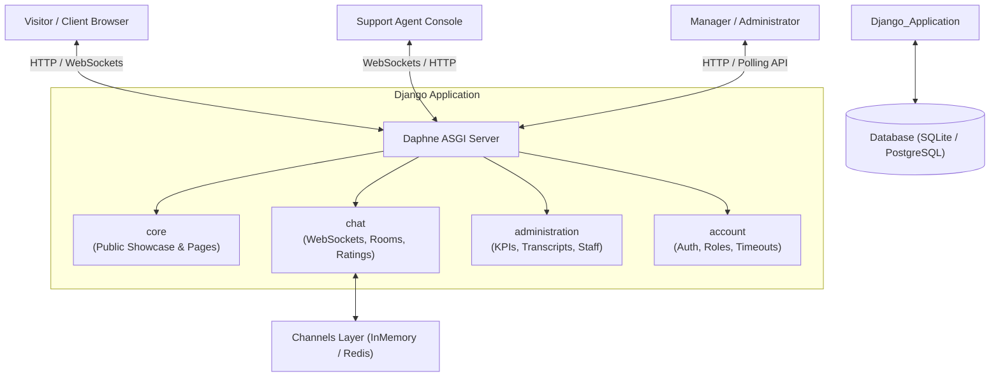

# valCRI — Enterprise Technology Solutions & Real-Time Support Platform

[](https://www.python.org/)
[](https://www.djangoproject.com/)
[](https://channels.readthedocs.io/)
[](https://tailwindcss.com/)
[](https://github.com/django/daphne)

**valCRI** is an all-in-one web platform combining a modern technology services portal with a high-performance, real-time live support chat system, dedicated agent control room, and comprehensive administrative analytics dashboard.

Powered by **Django**, **Django Channels (WebSockets)**, and **Daphne**, valCRI facilitates instant customer engagement, agent session auditing, conversation summaries, and post-service customer satisfaction ratings.

---

## 📑 Table of Contents

- [Overview & Architecture](#-overview--architecture)
- [Key Features](#-key-features)
  - [1. Public Services & Corporate Portal (`core`)](#1-public-services--corporate-portal-core)
  - [2. Real-Time Chat & Customer Engagement (`chat`)](#2-real-time-chat--customer-engagement-chat)
  - [3. Agent & Session Management (`account`)](#3-agent--session-management-account)
  - [4. Administration & Analytics Dashboard (`administration`)](#4-administration--analytics-dashboard-administration)
- [Tech Stack](#-tech-stack)
- [Project Structure](#-project-structure)
- [Getting Started](#-getting-started)
  - [Prerequisites](#prerequisites)
  - [Installation & Virtual Environment](#installation--virtual-environment)
  - [Database Setup & Migrations](#database-setup--migrations)
  - [Building Static Assets (Tailwind CSS)](#building-static-assets-tailwind-css)
  - [Running the Application](#running-the-application)
- [WebSocket & API Reference](#-websocket--api-reference)
- [Security & Session Policies](#-security--session-policies)
- [Deployment Considerations](#-deployment-considerations)
- [License](#-license)

---

## 🏛 Overview & Architecture

valCRI is structured around asynchronous real-time events and multi-role operations:



---

## ✨ Key Features

### 1. Public Services & Corporate Portal (`core`)
- **Modern Responsive Design**: Built with Tailwind CSS and clean typography.
- **Service Catalog**:
  - Custom Website Building & UI/UX design.
  - High-performance Cloud & Dedicated Hosting.
  - Full-stack Web Application Development.
  - Secure Remote Desktop Services & Infrastructure.
  - 24/7 Technical Troubleshooting & Managed IT Support.
- **Floating Live Chat Widget**: Easily accessible support trigger on all pages (`partials/chat_bubble.html`).

### 2. Real-Time Chat & Customer Engagement (`chat`)
- **WebSocket-Driven Messaging**: Instant, bidirectional messaging with low latency.
- **Session Preservation & Reconnect**: Visitors can refresh or navigate across pages without losing active chat history.
- **Typing Indicator & Online Presence**: Visual indicators when participants are active or typing.
- **Agent Assignment & Room Management**: Support staff can claim waiting rooms, communicate with customers, and gracefully close sessions.
- **Conversation Summaries (`ConvoSummary`)**: Agents can document case notes, resolution status, and follow-ups.
- **Customer Satisfaction Rating (`ServiceRating`)**: Visitors submit 1–5 star reviews across:
  - *Overall Experience*
  - *Responsiveness*
  - *Helpfulness*
  - *Qualitative Feedback / Comments*

### 3. Agent & Session Management (`account`)
- **Custom User Model**: UUID-based user entities supporting roles:
  - `agent`: Front-line support representative.
  - `manager`: Operational overseer with administrative capabilities.
  - `superuser`: Full system administrator.
- **Smart Session Timeout Middleware**:
  - **Idle Timeout**: Automatically logs inactive users out after **30 minutes** of inactivity.
  - **Absolute Timeout**: Enforces max session duration of **8 hours** to protect sensitive client data.
  - **Last Active Tracking**: Real-time resolution of online vs. offline agents based on live session inspection.

### 4. Administration & Analytics Dashboard (`administration`)
- **Real-Time KPI Cards**:
  - Live counts for Active, Waiting, and Closed rooms.
  - Currently active & online support agents.
  - Period filtering (`Today`, `This Week`, `This Month`).
- **CSAT Analytics**:
  - Aggregated average ratings for Overall Quality, Responsiveness, and Helpfulness.
- **Chat Transcript & Audit Archive**:
  - Search and inspect all historical conversations, associated client metadata, agent summaries, and feedback.
- **Team Management**:
  - Onboard new agents and managers.
  - View individual agent performance, workloads, and rating breakdowns.

---

## 🛠 Tech Stack

| Layer | Technology |
| :--- | :--- |
| **Backend Framework** | [Django](https://www.djangoproject.com/) (Python 3.10+) |
| **Asynchronous / WebSockets** | [Django Channels](https://channels.readthedocs.io/) & [asgiref](https://github.com/django/asgiref) |
| **ASGI Application Server** | [Daphne](https://github.com/django/daphne) |
| **Frontend Styling** | [Tailwind CSS 3.3](https://tailwindcss.com/) / `pytailwindcss` |
| **Frontend Scripting** | Vanilla JavaScript (Native WebSocket API, Fetch API, DOM manipulation) |
| **Database** | SQLite3 (Development) / PostgreSQL (Production ready) |
| **Channel Layer** | `InMemoryChannelLayer` (Dev) / `channels_redis` (Recommended for Prod) |

---

## 📁 Project Structure

```text
valCRI/
├── account/                    # Identity, authentication, and session security
│   ├── middleware.py           # Idle and absolute session timeout enforcement
│   ├── models.py               # Custom User model (UUID, Agent/Manager roles)
│   ├── utils.py                # Active session decoder and online status helpers
│   └── views.py                # Login, logout, and session lifecycle
├── administration/             # Executive analytics & management console
│   ├── templates/              # Dashboard, staff management, and report templates
│   ├── urls.py                 # Admin dashboard routing and JSON metrics endpoints
│   └── views.py                # Dashboard stats, room audits, staff management
├── chat/                       # Real-time WebSocket engine and chat features
│   ├── consumers.py            # AsyncWebsocketConsumer handling rooms & events
│   ├── models.py               # Room, Message, ConvoSummary, ServiceRating
│   ├── routing.py              # WebSocket routing (`ws/<str:room_name>/`)
│   ├── templates/              # Chat agent workspace, room views, chat bubbles
│   └── views.py                # Room APIs, rating submissions, summary endpoints
├── core/                       # Public portal and services catalog
│   ├── templates/core/         # Home, About, Services detail templates
│   └── views.py                # Informational page controllers
├── static/                     # Static assets (compiled CSS, custom JS, images)
│   ├── css/                    # Tailwind CSS output (main.min.css)
│   └── js/                     # main.js (visitor chat client), main_admin.js
├── valcri/                     # Project configuration root
│   ├── asgi.py                 # Channels ASGI protocol routing (HTTP & WebSocket)
│   ├── settings.py             # Project settings, middleware, channel layers
│   ├── urls.py                 # Root URL dispatcher
│   └── wsgi.py                 # WSGI configuration
├── db.sqlite3                  # Local development SQLite database
├── manage.py                   # Django CLI entrypoint
├── package.json                # Tailwind CSS package definitions
├── requirements.txt            # Python dependencies
└── tailwind.config.js          # Tailwind template paths and configurations
```

---

## 🚀 Getting Started

### Prerequisites

- **Python**: Version 3.10 or higher
- **Node.js & npm** *(Optional, if compiling Tailwind via npm)*

### Installation & Virtual Environment

1. **Clone the repository:**
   ```bash
   git clone <repository-url>
   cd valcri/valCRI
   ```

2. **Create and activate a virtual environment:**
   ```bash
   # On Windows (PowerShell)
   python -m venv venv
   .\venv\Scripts\Activate.ps1

   # On macOS / Linux
   python3 -m venv venv
   source venv/bin/activate
   ```

3. **Install dependencies:**
   ```bash
   pip install -r requirements.txt
   ```

### Database Setup & Migrations

Apply migrations to initialize user models, rooms, summaries, and ratings:

```bash
python manage.py migrate
```

Create an initial staff / manager user:

```bash
python manage.py createsuperuser
```
*(Enter your name, email, and password when prompted)*

### Building Static Assets (Tailwind CSS)

Tailwind styles can be compiled using either the Node build script or `pytailwindcss`:

```bash
# Using Node / npx:
npx tailwindcss -i ./static/css/main.css -o ./static/css/main.min.css --minify

# Or watch for changes during development:
npx tailwindcss -i ./static/css/main.css -o ./static/css/main.min.css --watch
```

### Running the Application

Because valCRI uses **WebSockets**, it must be run with an ASGI server. In development, running `manage.py runserver` leverages Daphne automatically:

```bash
python manage.py runserver
```

Once started:
- **Public Portal & Chat Widget**: [http://127.0.0.1:8000/](http://127.0.0.1:8000/)
- **Agent Chat Workspace**: [http://127.0.0.1:8000/chat-agent/](http://127.0.0.1:8000/chat-agent/)
- **Administrative Dashboard**: [http://127.0.0.1:8000/admin-dashboard/](http://127.0.0.1:8000/admin-dashboard/)
- **Django Superadmin**: [http://127.0.0.1:8000/admin/](http://127.0.0.1:8000/admin/)

---

## 🔌 WebSocket & API Reference

### WebSocket Protocol (`ws://<host>/ws/<room_uuid>/`)

Managed by `chat.consumers.ChatConsumer`:

| Direction | Event `type` | Payload Keys | Description |
| :--- | :--- | :--- | :--- |
| **Client → Server** | `message` | `name`, `message`, `agent` | Dispatches a chat message to the room. |
| **Client → Server** | `update` | `name` | Sends typing or activity heartbeat. |
| **Server → Client** | `chat_message` | `name`, `message`, `agent`, `created_at`, `initials` | Broadcasts new message to participants. |
| **Server → Client** | `chat_history` | `messages` | Sends prior message transcript on re-connection. |
| **Server → Client** | `writing_active`| `name` | Informs other party that someone is typing. |
| **Server → Client** | `users_update` | — | Broadcasts that an agent has joined the room. |
| **Server → Client** | `room_closed`  | — | Notifies the client that the session has ended. |

### REST Endpoints

| Endpoint | Method | Role | Description |
| :--- | :--- | :--- | :--- |
| `/api/create_room/<uuid>/` | `POST` | Public | Initializes a room or reopens closed session. |
| `/api/close_room/<uuid>/` | `POST` | Agent/Admin | Closes room and emits `room_closed` WebSocket alert. |
| `/api/submit_rating/<uuid>/` | `POST` | Public | Stores customer satisfaction review and feedback. |
| `/api/check_rating/<uuid>/` | `GET` | Public | Returns whether feedback has already been submitted. |
| `/rooms/<uuid>/save-summary/` | `POST` | Agent/Admin | Persists agent post-call summary and notes. |
| `/administration/api/stats/` | `GET` | Staff | Returns live dashboard counts (JSON format). |
| `/administration/rooms-partial/`| `GET` | Staff | Returns updated HTML table rows for active rooms. |

---

## 🔒 Security & Session Policies

To maintain operational integrity and prevent unattended terminal access:
- **Idle Timeout (`SESSION_IDLE_TIMEOUT`)**: Configured to **1800 seconds (30 mins)**. If no requests are recorded within this window, the user is automatically logged out and redirected to `/login/?reason=idle`.
- **Absolute Timeout (`SESSION_ABSOLUTE_TIMEOUT`)**: Configured to **28800 seconds (8 hours)**. Forces re-authentication at the end of a shift regardless of continuous activity.
- **Access Control**: Chat views, staff dashboards, and mutation endpoints are protected via `@login_required` and staff permission gates.

---

## 🌐 Deployment Considerations

When moving to a production environment:

1. **ASGI Application Server**: Run with [Daphne](https://github.com/django/daphne) or [Uvicorn](https://www.uvicorn.org/) behind Nginx.
2. **Channel Layers with Redis**: Swap `InMemoryChannelLayer` for `channels_redis`:
   ```python
   CHANNEL_LAYERS = {
       "default": {
           "BACKEND": "channels_redis.core.RedisChannelLayer",
           "CONFIG": {
               "hosts": [("127.0.0.1", 6379)],
           },
       },
   }
   ```
3. **Environment Variables**: Move `SECRET_KEY`, `DEBUG`, and database credentials to environment variables or a `.env` file.
4. **Database**: Use PostgreSQL or MySQL in place of SQLite for concurrent write performance.
5. **HTTPS & WSS**: Ensure Nginx terminates SSL and upgrades connection headers (`Upgrade $http_upgrade`, `Connection "upgrade"`) for WebSocket traffic.

---

## 📄 License

This project is proprietary software developed for **valCRI**. All rights reserved.
e